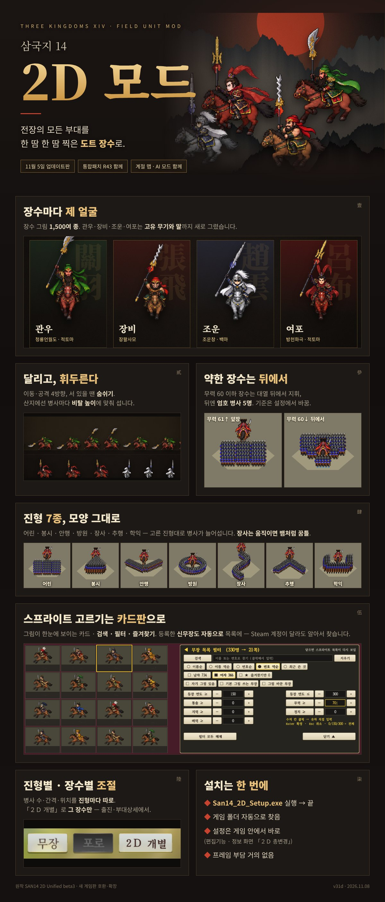

# 삼국지 14 · 2D 모드

필드 부대를 한 땀 한 땀 찍은 **도트 장수 그림**으로 바꾸는 모드입니다.

## 받기 · 설치

1. 이 페이지 위 초록 **[Code] → [Download ZIP]** 으로 받습니다 (약 30MB).
2. ZIP 을 **새 폴더에 통째로 풀고**, 그 안의 **`설치.cmd`** 를 더블클릭합니다.
   - 설치기를 윈도우에 들어 있는 도구로 이 PC 에서 몇 초 만에 만들어 바로 띄웁니다. 그래서 '일반적으로 다운로드되지 않는 파일' 경고가 안 뜹니다.
3. 설치기가 게임 폴더를 자동으로 찾습니다. 큰 단추 **[설치]** 를 누르면 끝.
   - 처음 설치 때 장수 그림 묶음(약 1.4GB)을 한 번 받습니다. 끊겨도 다시 누르면 이어서 받습니다.
   - 이미 `assets.zip` 을 갖고 있으면 풀어 둔 폴더(또는 그 옆 폴더)에 두세요 — 다시 받지 않습니다.
4. 새 판이 나오면 `설치.cmd` 를 다시 실행하고 **[업데이트]** — 바뀐 파일만 받습니다(보통 수 MB). 내 설정은 그대로.
5. 옛 판으로 돌아가려면 오른쪽 **판별 업데이트 내역**에서 「↺ 이 판으로」.

> **필수** · 통합패치 **11번(필드 부대 3D 조형)** 과는 같이 못 씁니다. 통합패치 설치기에서 11번을 빼고 [적용]한 뒤 2D 모드를 설치하세요.

- 게임: **11월 5일 업데이트판** 전용 (SAN14CE_KO.exe)
- 함께 쓰기: 통합패치 최신판 · 계절 맵 · AI 모드 · 기색 모드
- 설정: 게임 안 정보 화면 「２Ｄ 총변경」 · 편집기능 「２Ｄ 무장 스프라이트 설정」 · 출진/부대상세 「２Ｄ 개별」

## 판 목록

판별 바뀐 점은 설치기 오른쪽 칸에서 볼 수 있습니다. 목록 원본: [`updates/index.json`](updates/index.json)

| 판 | 날짜 | 바뀐 점 |
|---|---|---|
| v31e | 2026-11-12 | 언 강 높이 고침 · 새로 빌드된 AI 모드도 설치기가 알아봄 |
| v31d | 2026-11-08 | 언 강 위 그림이 얼음 위에 섬 · 장수 그림 실패 알림 창 |
| v31c | 2026-11-07 | 카드판 글꼴 = 게임 글꼴 |
| v31b | 2026-11-07 | 부대상세 「２Ｄ 개별」 단추 자리 |
| v31 | 2026-11-07 | 11월 5일 게임판 호환 · 진형별 설정 · 카드판 · 장사 물결 |

## 저장소 구성

- `설치.cmd` · `support/installer/` — 설치기(소스로 받아 이 PC 에서 만듦)
- `updates/index.json` — 판 목록(설치기가 읽음)
- `updates/<판>/manifest.json`, `core.zip` — 판마다 프로그램 묶음(되돌리기용으로 옛 판도 둠)
- 장수 그림 묶음 `assets.zip` — [배포 assets-1](https://github.com/wprkfdid12-ux/san14ce-2d-mod/releases/tag/assets-1)

원작: SAN14 2D Unified beta3 · 새 게임판 호환·확장
